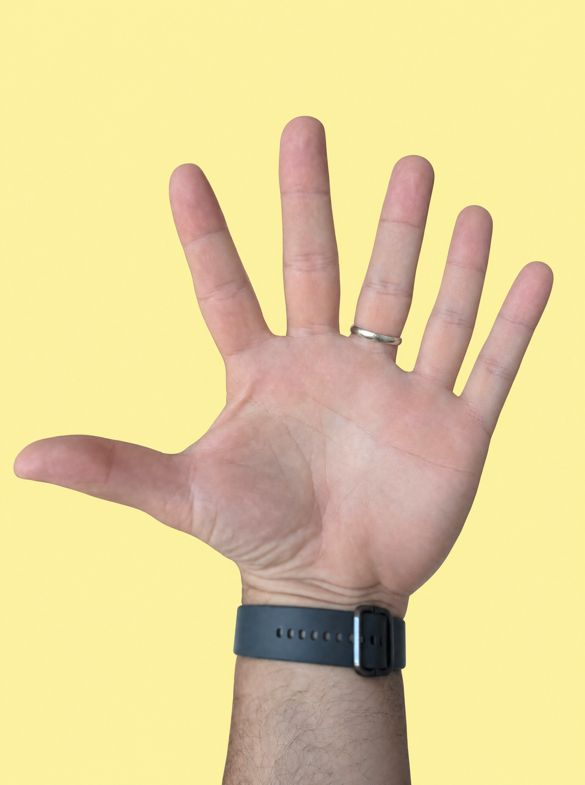

<p align="center">
  
</p>

<h1 align="center">LoLo6Fingers</h1>

<p align="center">
  A simple YouTube & Instagram downloader for macOS, made for video editors.<br>
  Built on <a href="https://github.com/yt-dlp/yt-dlp">yt-dlp</a> and ffmpeg.
</p>

---

## Why another downloader?

Most downloaders give you whatever YouTube serves — often **AV1 or VP9**,
which **Adobe Premiere cannot open**. LoLo6Fingers checks the codec after
each download and re-encodes to **H.264** only when needed, using the
**GPU** (Apple VideoToolbox) for speed.

## Features

- **YouTube and Instagram** (and most sites yt-dlp supports)
- **Premiere-ready output** — AV1/VP9 is detected and re-encoded to H.264 automatically
- **GPU re-encoding** on Apple Silicon, with automatic CPU fallback and the reason shown when the GPU fails
- **4K → H.264** with progress, time left and a cancel button
- **Fallback chain** for stubborn YouTube videos: alternative player clients, retry without cookies, PO-token workaround
- **"What can be downloaded?"** diagnostics — shows what YouTube really offers (formats, DRM, login required, storyboards only)
- **Login support** for private / age-restricted videos: Chrome profile picker or a `cookies.txt` file
- **Live stream recordings** downloaded from the start
- **Bundled Deno** JavaScript runtime in the `.app`, so YouTube challenges get solved without installing anything
- Update check for yt-dlp (stable and nightly)

## Download

Get the ready-made app from the **[Releases](https://github.com/Norris87/LoLo6Fingers/releases/latest)** page —
download `LoLo6Fingers-x.y-macOS.zip` and follow **[INSTALL.md](INSTALL.md)**.

Requirements: a Mac with **Apple Silicon (M1–M5)**. Nothing else to install.

> The app is not signed with an Apple developer certificate, so macOS blocks
> it on first launch. [INSTALL.md](INSTALL.md) shows the one-line fix.

## Run from source

```bash
git clone https://github.com/Norris87/LoLo6Fingers.git
cd LoLo6Fingers
```

Then double-click, in this order:

| Script | What it does |
|---|---|
| `setup.command` | First run: Python venv, libraries, icon, ffmpeg (needs Python 3.11+, uses Homebrew for ffmpeg) |
| `run.command` | Starts the app from source |
| `update.command` | Updates yt-dlp — stable or nightly |
| `setup-potoken.command` | Optional: installs a [PO Token provider](https://github.com/Brainicism/bgutil-ytdlp-pot-provider) (needs Node.js 22+) for videos that return "storyboards only" |
| `package.command` | Builds `LoLo6Fingers.app` and a zip ready for a Release |

On a fresh download macOS may refuse to run the `.command` files; fix it once with:

```bash
chmod +x *.command
```

## When a YouTube video will not download

1. Click **What can be downloaded?** — it tells you the cause.
2. **Login required** → use a `cookies.txt` file, see [COOKIES.md](COOKIES.md).
3. **Storyboards only** → run `setup-potoken.command`, or `update.command` → nightly.
4. **DRM** → cannot be downloaded, by design.
5. Videos that worked before and suddenly stop → update yt-dlp. YouTube changes often.

## Project layout

```
lolo6fingers.py        the whole app (Tkinter GUI + yt-dlp + ffmpeg)
LoLo6Fingers.spec      PyInstaller build for macOS
windows/               experimental Windows build
*.command              setup / run / update / package scripts
INSTALL.md             installing the ready-made app
COOKIES.md             getting a working cookies.txt
CHANGELOG.md           version history
```

## Responsible use

Download only content you have the right to download — your own videos,
Creative Commons material, or with the owner's permission — and respect
YouTube's Terms of Service and copyright law where you live. LoLo6Fingers
does **not** bypass DRM; DRM-protected videos are reported and skipped.

## Credits

- [yt-dlp](https://github.com/yt-dlp/yt-dlp) — the download engine
- [FFmpeg](https://ffmpeg.org) — encoding and merging
- [Deno](https://deno.com) — JavaScript runtime for YouTube challenges
- [bgutil-ytdlp-pot-provider](https://github.com/Brainicism/bgutil-ytdlp-pot-provider) — optional PO token provider

## License

[MIT](LICENSE) © Norrislav
